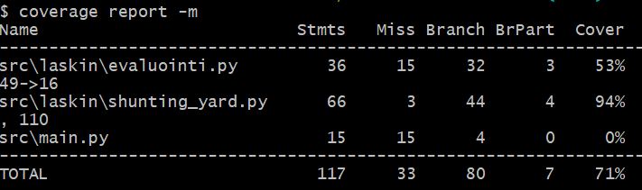

# Testausdokumentti

## Kattavuus raportti

## Yksikkö testaus

Algoritmin toiminta on testattu perus syötteillä. Laskeminen on testattu peruslaskutoimituksilla (+,-,*,/). Muutujaan arvon sijoittaminen on testattu myös. Tokenisointi on testattu kaikille mahdollisille syötteille.

## Testien toistaminen

Testit voi suorittaa komenolla:

poetry run pytest -v