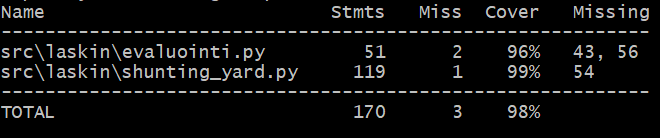

# Testausdokumentti

## Kattavuus raportti

## Yksikkö testaus

Algoritmin toiminta on testattu perus syötteillä. Laskeminen on testattu peruslaskutoimituksilla (+,-,*,/) ja min, max, sqrt, sin, tan ja cos funktioilla. Muuttujaan arvon sijoittaminen on testattu myös. Tokenisointi on testattu kaikille mahdollisille syötteille. Kaikki virhe tapaukset on myös testattu.

## Testien toistaminen

Testit voi suorittaa komenolla:

poetry run pytest -v